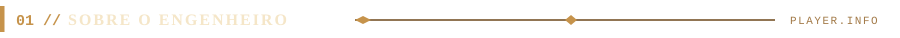
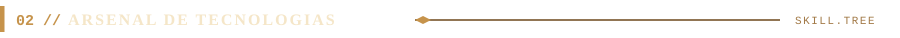
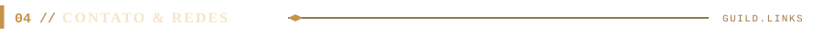

  <!-- 1. BANNER VETORIAL AMADEIRADO COM SETUP DE 2 MONITORES -->
  

 

<!-- 2. INSÍGNIAS PRINCIPAIS (SHIELDS.IO CUSTOMIZADO EM TOM BRONZE/MADEIRA + LOGO LWSA) -->

  
  
  
  

 

<!-- 3. SEÇÃO 01 // SOBRE O ENGENHEIRO (DIVISOR + CARD PERGAMINHO & MADEIRA) -->

  
    
  

 

<!-- 4. SEÇÃO 02 // ARSENAL DE TECNOLOGIAS (DIVISOR + SKILL ICONS + LEMA VETORIAL) -->

  
    
  
    
  

 

<!-- 5. SEÇÃO 03 // MAPA DE ENGENHARIA & ARQUITETURA (DIVISOR + TABELA RPG VETORIAL) -->

  
    
  

 

<!-- 6. SEÇÃO 04 // CONTATO & REDES (DIVISOR + PLACAS DE BRONZE) -->

  
    
  
  
  

