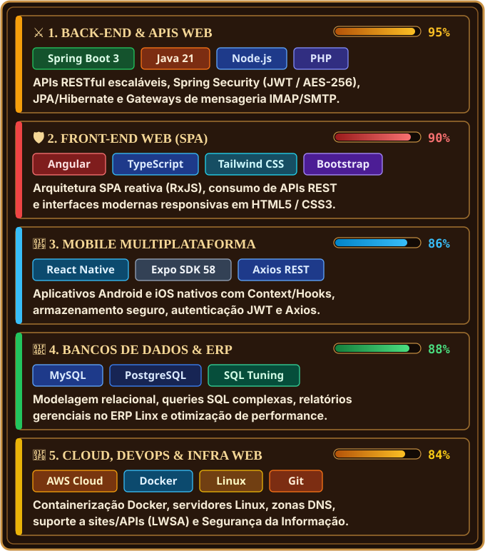

<!-- ================================================================= -->
<!-- PERFIL GITHUB: ANTONIO MIKAEL (FSMikael) - TEMA RPG AMADEIRADO    -->
<!-- RESPONSIVO (MOBILE & DESKTOP) + ADAPTÁVEL (MODO ESCURO & CLARO)   -->
<!-- ================================================================= -->

  

 

<!-- CREDENCIAIS PRINCIPAIS -->

  
  
  
  

 

<!-- 01 // SOBRE O ENGENHEIRO -->

  
    
  

 

<!-- 02 // ARSENAL DE TECNOLOGIAS (Adapta entre Modo Claro e Escuro + 6 por linha para Mobile/Desktop) -->

  
    
  <picture>
    <source media="(prefers-color-scheme: dark)" srcset="https://skillicons.dev/icons?i=java,spring,angular,ts,js,react,html,css,bootstrap,tailwind,nodejs,php,mysql,postgres,aws,docker,git,linux&perline=6&theme=dark" />
    <source media="(prefers-color-scheme: light)" srcset="https://skillicons.dev/icons?i=java,spring,angular,ts,js,react,html,css,bootstrap,tailwind,nodejs,php,mysql,postgres,aws,docker,git,linux&perline=6&theme=light" />
    
  </picture>
    
  

 

<!-- 03 // MAPA DE ENGENHARIA & ARQUITETURA -->

  
    
  

 

<!-- 04 // CONTATO & REDES -->

  
    
  
  
  

